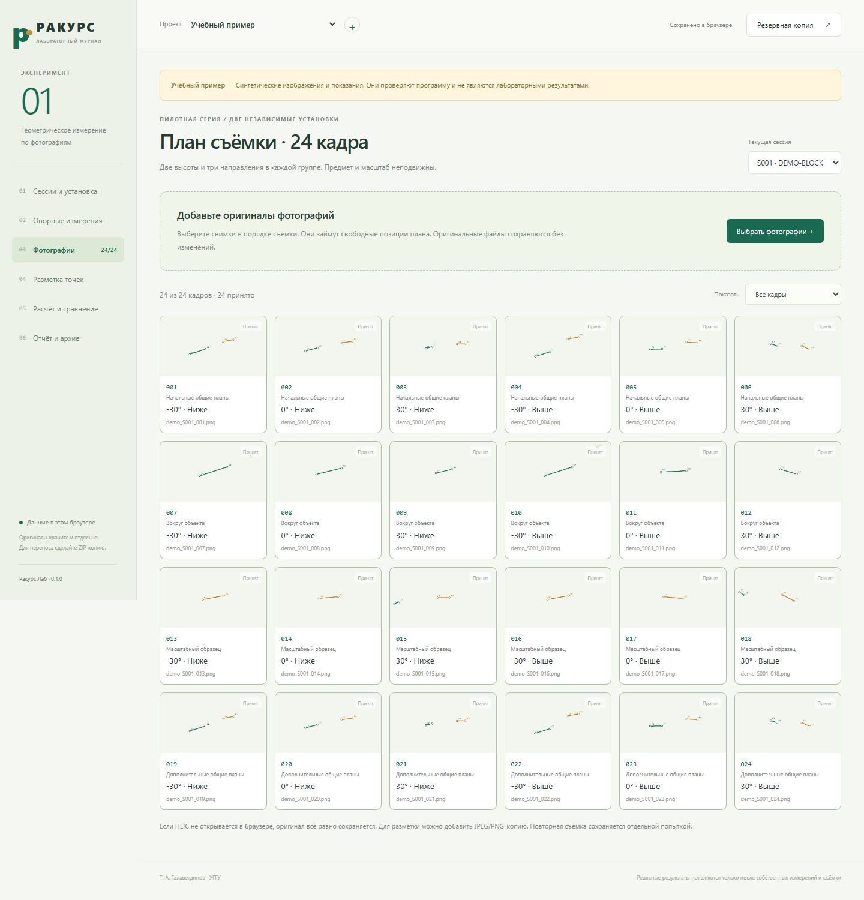

# Ракурс · эксперимент 01

Лабораторный журнал первого пилота: один предмет, отдельный масштабный образец, две независимые установки и по 24 фотографии. Данные и фотографии сохраняются в браузере. Серверная обработка и отправка фотографий отсутствуют.



## Запуск

Откройте `index.html` в современном Chrome или Edge. Для стабильного адреса локального хранилища предпочтителен запуск `npm start` (нужен Node.js 22+) с открытием `http://127.0.0.1:4173`. Устанавливать npm-пакеты не требуется. Можно использовать обычный статический HTTPS-хостинг.

Адрес сайта, браузер и профиль определяют хранилище. На другом адресе прежние данные не появятся сами. Переносите их полным резервным ZIP. Очистка данных сайта может удалить локальный журнал. Оригиналы храните и отдельной папкой.

## Как провести пилот

1. В разделе «Сессии» укажите предмет, смартфон и условия. S001 и S002 — отдельные установки. Во второй сессии заново установите сцену и повторите опорные измерения.
2. Запишите пять показаний масштаба R1–R2 и пять контрольных показаний предмета O1–O2. Концы отрезков должны быть однозначными и неизменными. Контроль не задаёт масштаб и не участвует в выборе кадров.
3. Укажите прибор, повторную установку и обоснованную **стандартную** составляющую uB. Разрешение прибора не подставляется вместо uB. Пустое поле оставляет бюджет неполным. Нулевое uB допустимо только с собственным обоснованием.
4. Снимите план из 24 кадров. 001–006: начальные общие; 007–012: вокруг предмета; 013–018: вокруг масштаба; 019–024: дополнительные общие. В каждой группе две высоты × три направления −30°, 0°, +30°. Это ориентиры плана, а не измеренные позы камер. Между снимками сцена неподвижна, объектив один, цифровой зум отключён.
5. Добавляйте оригиналы в нужном порядке. Пакет занимает свободные позиции, а конкретный кадр можно открыть и загрузить отдельно. Проверьте порядок после импорта. Неудачные снимки отклоняйте с причиной; пересъёмку добавляйте новой попыткой. Учитываются все видимые точки независимо от группы кадра.
6. Разметьте O1, O2, R1, R2 на рабочих PNG. Колесо увеличивает, перетаскивание двигает изображение. Скрытые точки отметьте как скрытые. Не угадывайте координаты. Рабочие PNG полноразмерные, с применённой ориентацией оригинала. Начало координат — верхний левый **угол** изображения, центр первого пикселя (0,5; 0,5), как в COLMAP.
7. Скачайте рабочие PNG, восстановите камеры во внешнем COLMAP и импортируйте два TXT из одной модели. Рассчитайте длину и сравните стратегии. Это ретроспективный анализ с фиксированными камерами.
8. Скачайте полный резервный ZIP и HTML-отчёт. Архив содержит все попытки и оригинальные байты. Он восстанавливается отдельным проектом без перезаписи предыдущего.

## Учебный набор

Кнопка «Открыть учебный пример» создаёт отдельный проект: 48 искусственных изображений, показания и известные камеры. В интерфейсе и отчёте он помечен как синтетический. Его можно использовать для освоения разметки, расчёта и архивирования. Он не считается лабораторной серией.

## Реальная реконструкция

COLMAP устанавливается отдельно. Без его камер приложение остаётся журналом и разметчиком; размеры не вычисляются из отношения отрезков на одном фото. Используйте текстурированные предметы, перекрывающиеся снимки, неподвижные фон и сцену. Гладкий однотонный предмет может не зарегистрироваться. Контрольные метки не заменяют достаточную текстуру сцены.

Распакуйте рабочий архив. Если доступны Python 3.10+ и COLMAP:

```powershell
python tools/reconstruct.py --images "D:/Experiment/S001/images" --output "D:/Experiment/S001/run-01" --colmap "C:/COLMAP/bin/colmap.exe"
```

Папка результата должна быть новой. Помощник запускает CPU-извлечение признаков, полное сопоставление и mapper, сохраняет журнал, исходную БД и все модели. Из крупнейшей связанной модели создаёт `selected/cameras.txt` и `selected/images.txt` для импорта. Раздельные модели не смешиваются. По умолчанию единая камера SIMPLE_RADIAL: используйте один объектив без зума; для смешанных камер настраивайте COLMAP вручную. Используются актуальные или прежние названия CPU-настроек, найденные через справку установленной версии.

Поддерживаются SIMPLE_PINHOLE, PINHOLE, SIMPLE_RADIAL, RADIAL, OPENCV, FULL_OPENCV с дисторсией. Fisheye отклоняется. Размеры и имена камер должны соответствовать экспортированным рабочим PNG.

## Математика и границы результата

Четыре 3D-точки оцениваются минимизацией суммы квадратов пиксельных ошибок репроекции. Инициализация линейная, затем Гаусс–Ньютон. Для точки при фиксированных камерах: `H = Σ JᵀJ / σ²`, `Cov(X) ≈ H⁻¹`. Вырожденная геометрия отклоняется.

Длина `q = L · ||O2−O1|| / ||R2−R1||`. Дисперсия получается линейным распространением ковариаций четырёх точек и независимой опорной длины L. Межточечные корреляции, погрешности камер, общие ошибки разметки и несоответствие модели в бюджет не включены. Полный условный интервал выдаётся только при заполненном u(L). Формула `q ± 1,96u` — приближение с нормальным коэффициентом, не подтверждённое покрытие 95%.

Следующий кадр оценивается по ожидаемому уменьшению этой дисперсии при добавлении `JᵀJ / σ²` к информационным матрицам текущих точек. Будущая фактическая разметка и контрольная длина не входят в оценку кандидатов. Предполагается видимость спроецированных точек внутри кадра; перекрытия и смаз заранее не прогнозируются. Положение каждого кандидата известно из полной реконструкции, что ограничивает выводы ретроспективной проверкой. Это не готовый онлайн-навигатор смартфона.

Семь стратегий используют одинаковые шесть начальных кадров и до шести дополнительных. «План по первым кадрам» планирует последовательность без новых измерений; адаптивная стратегия после каждого выбранного кадра уточняет точки. Периодические стратегии выбирают геометрически лучший доступный кадр нужной группы. Случайная стратегия имеет фиксированное зерно 42. Неполные пути явно отмечаются. Одна серия не доказывает статистическое преимущество. Порог точности согласуется с руководителем; приложение не задаёт универсальный отраслевой допуск.

## Форматы и приватность

- `manifest.json` полного архива: схема 1, проект, пути файлов, размеры, SHA-256 оригиналов и рабочих PNG; ZIP дополнительно проверяет CRC32.
- CSV: все попытки, видимость, координаты в рабочих PNG и исходные показания. Координаты не относятся к уменьшенным миниатюрам.
- Рабочий ZIP для COLMAP содержит активные PNG и `analysis-input.json` без контрольных показаний. Произвольные пользовательские примечания перед экспортом проверьте самостоятельно: не вписывайте туда скрываемую контрольную длину.
- Оригинальный файл и его EXIF не изменяются. EXIF автоматически не интерпретируется как точная поза.
- HEIC сохраняется и при невозможности декодирования; отдельно можно приложить JPEG/PNG-копию. Пиксельная система разметки относится именно к этой копии. Замена уже размеченной копии не допускается; добавляйте новую попытку.
- Персональные фото, резервные архивы и результаты съёмки не включены в исходники. Перед публикацией собственных файлов отдельно проверьте их содержимое.

## Проверка

`npm test` — воспроизводимые проверки геометрии, дисторсии, сопоставления камер, стратегии без контрольной подсказки и ZIP. `python -m unittest discover -s tests -p "test_*.py"` — проверки помощника. Описание браузерных проверок: [docs/validation.md](docs/validation.md).

В этой поставке реальные фотографии не снимались, установленный COLMAP не запускался. Компьютерные проверки не заменяют лабораторный эксперимент.

## Источники и статус

[Формат COLMAP](https://colmap.github.io/format.html), [интерфейс команд COLMAP](https://colmap.github.io/cli.html), [система пиксельных координат COLMAP](https://github.com/colmap/colmap/blob/main/doc/database.rst), [IndexedDB](https://developer.mozilla.org/en-US/docs/Web/API/IndexedDB_API).

Автор научного проекта: Т. А. Галаветдинов, УГГУ. Прототип подготовлен с помощью ИИ; научные выводы требуют независимой проверки. Лицензия распространения пока не выбрана, права автоматически не передаются.
